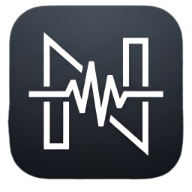

# NikaMusic

**A fast, modern, free music player for the web.**
Hindi, English, Punjabi, Nepali, Tamil, Telugu and more, in one clean Spotify-style app.

### [Open NikaMusic](https://nikamusic.onrender.com)

---

## What is NikaMusic?

NikaMusic is a music player that runs in your browser. There is nothing to download and no account is needed. Open the site, search for a song, and press play.

## Features

**Listening**
- A home feed that mixes Hindi, English, Punjabi, Nepali, Tamil, Telugu, Bengali and Marathi
- Featured Artists, Trending Hits, New Releases, Featured Albums and Curated Playlists
- Infinite radio: when your queue ends, similar songs keep playing
- Queue with drag-and-drop ordering, shuffle and repeat
- Synced lyrics that follow the song
- Crossfade, sleep timer, audio quality choice and keyboard shortcuts
- Full-screen Now Playing view

**Your library**
- Liked Songs and your own playlists
- Follow your favourite artists
- Import and export your playlists
- Download tracks

**Artist, album and playlist pages**
- Artist pages with a photo hero, popular songs, albums, singles and similar artists
- Play, shuffle, artist radio, follow and share
- Every artist, album and playlist has its own shareable link

**Look and feel**
- Works on phones, tablets and desktops
- Dark and light modes with your choice of accent colour
- Placeholder artwork whenever a cover cannot be loaded
- A clear message and automatic recovery if the music service is briefly unavailable

## Languages

| | | | |
|---|---|---|---|
| Hindi | English | Punjabi | Nepali |
| Bengali | Marathi | Gujarati | Tamil |
| Telugu | Kannada | Malayalam | Bhojpuri |
| ...and more | | | |

## Install it as an app

NikaMusic is a progressive web app, so you can add it to your home screen or desktop.

- **Android (Chrome):** open the site, tap the menu, then **Install app**
- **iPhone (Safari):** tap Share, then **Add to Home Screen**
- **Desktop (Chrome or Edge):** click the install icon in the address bar

## Discord status

On a desktop computer you can show what you are listening to on your Discord profile. Sign in with Discord from **Settings → Discord Integration**, then follow the short guide on that page. Discord only allows desktop programs to set a status, so this does not work on phones.

## Keyboard shortcuts

| Key | Action |
|---|---|
| `Space` | Play / pause |
| `←` / `→` | Seek 5 seconds back / forward |
| `↑` / `↓` | Volume up / down |
| `N` / `P` | Next / previous song |
| `L` | Like the current song |
| `S` / `R` | Shuffle / repeat |
| `T` | Cycle the sleep timer |
| `?` | Show all shortcuts |

Open **Settings → Keyboard shortcuts** inside the app for the full list.

## Privacy

- No sign-up is required to listen.
- Your likes, playlists and settings are stored on your own device.
- Signing in with Discord is optional. It only reads your name, username and avatar, and your Discord password is never shared with NikaMusic.
- Anonymous, cookie-free statistics may be collected (pages visited and simple counters). Search text and song titles are never recorded.

## About this repository

NikaMusic's source code is private. This page describes the project for visitors, and the code is not available for download, copying or redistribution.

## Disclaimer

NikaMusic does not host any audio files. Music information and streams come from third-party services. All songs, artwork and names belong to their respective owners. If you are a rights holder and have a concern, please get in touch through the website.

## Copyright

© 2026 NikaMusic. All rights reserved.
